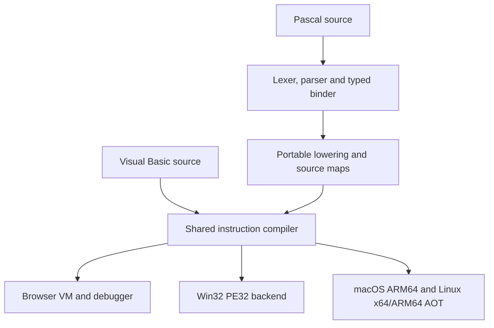

# Turbo Pascal in VB6 Studio

VB6 Studio offers **Turbo Pascal 7.0** as an optional project and module language. Pascal uses the same forms, control catalog, project files, runtime, debugger, MCP service, and export commands as Visual Basic. Projects without language metadata retain their Visual Basic behavior.

The source target is Borland's final Turbo Pascal language release. This implementation includes its own JavaScript lexer, parser, semantic binder, and portable runtime lowering. It is not a wrapper around an installed compiler. It supports substantial TP7 language behavior, including value objects and virtual methods, but does **not** claim complete TP7/DOS binary compatibility or current Delphi compatibility. The limitations below are part of the contract.

## Create a Pascal application

Open **File → New Project**, select **Standard EXE**, choose **Turbo Pascal 7.0** under **Programming language**, and open the project. Add forms and controls using the existing designer. Double-click a control or select an event to create its Pascal handler.

The **Turbo Pascal Forms** example is also available in New Project. Its text box, greeting button, label, and `var KeyAscii` handler demonstrate the shared component model. The editable source project is [pascal-forms.vb6web](../examples/pascal-forms.vb6web).

```pascal
unit Form1;

interface

implementation

procedure GreetButton_Click;
begin
  GreetingLabel.Caption := 'Hello, ' + NameText.Text + '!';
end;

procedure NameText_KeyPress(var KeyAscii: Integer);
begin
  if KeyAscii = 13 then
  begin
    GreetButton_Click;
    KeyAscii := 0;
  end;
end;

end.
```

Controls, event signatures, mutable event parameters, properties, menus, resource models, layout, themes, and rendering come from the existing host. Their [documented control and platform limits](COMPATIBILITY.md) still apply. Adding Pascal does not make an unsupported control operation available on a native target.

## Project and source files

`project.language` defines the default and `module.language` supplies an explicit override. Supported canonical values are `vb6` and `pascal`. Language is independent of form/module kind, designer theme, renderer, and export target. Changing a project's default preserves existing module languages; it does not translate their text.

Pascal files use `.pas` or `.pp` and UTF-8. Source ZIPs preserve each module's source filename and folders, include a form companion named `<source filename>.form.json` (for example `Form1.pas.form.json` or `forms/Main.pp.form.json`), and retain project metadata and assets in a `.vb6web` manifest. Import overlays the editable source files onto that manifest. Pascal form source and designer state therefore survive source export/import without converting either to VB syntax. A normal `.vb6web` save also retains language metadata.

Visual Basic and Pascal modules can coexist. Use the shared `compileProject` API for project-wide dispatch. Pascal unit interfaces and private implementation sections determine Pascal visibility. Unit initialization follows dependencies, executes once, and runs before Main or form initialization. Interface cycles diagnose; implementation-only cycles are handled by initialization guards.

The Microsoft VB6 executable/compiler export route rejects Pascal source with `CLASSIC_LANGUAGE`. Use the browser runtime or the independent AOT exporters for Pascal projects.

## Mixed Visual Basic projects

Pascal binds the public declarations of Visual Basic standard modules and classes through the existing VB parser and constant binder. Standard-module members can be qualified (`Helper.Answer`) or unqualified when unambiguous. Class variables retain their declared type, including factory return values, public fields, methods, and `Property Get`/`Let`/`Set` accessors. Private declarations, missing members, incompatible arguments, read-only writes, and write-only reads produce source diagnostics.

```pascal
program Main;
var Counter: CounterClass;
begin
  Counter := Factory.MakeCounter;
  Counter.Value := Helper.Answer;
  Counter.Entry(2) := 12;
  WriteLn(Counter.Entry(2));
end.
```

The example assumes VB modules declaring the named class, factory, and helper. Their `Optional` defaults, `ParamArray`, and `ByRef` signatures remain authoritative. VB enums and record/array fields retain bound constant values, dimensions, and nominal record identity. Different modules' same-named records are distinct types. Foreign receivers and argument values evaluate in source order; an array-element borrow remains held while later arguments execute, including through generated argument procedures.

A qualified form instance exposes its shared form methods, properties, controls, menus, and sparse control arrays. For example, `Form1.Caption := 'Ready'`, `Form1.Show`, and `Form1.Buttons[7].Caption := 'Run'` use the existing form host. Control arrays also accept `Buttons(7)`, and `Low`/`High` report the host's current bounds after dynamic loading. A Pascal form unit must appear in the caller's `uses` clause; explicit unit visibility still protects its private declarations.

`WithEvents` subscription declarations remain in VB class/form modules. A VB event sink can invoke an authored Pascal procedure with `var` parameters; the shared call and event ABI preserves synchronous callbacks and mutable event arguments. Pascal does not introduce a new `WithEvents` declaration syntax.

Pascal short strings and characters have bounded storage. A mutable VB `ByRef` argument cannot directly alias those values or aggregates containing them: a VB write could otherwise bypass Pascal's capacity rules. The compiler diagnoses that case. Use explicit VB String storage for the call, then assign its result to a Pascal string to apply the declared bound. Value arguments, VB-owned strings, and VB-owned string arrays retain their normal contracts. Native exports also retain the existing backend limits, including Win32's unsupported typed-array return ABI and class-array fields.

## Architecture and reuse



The Pascal frontend lowers to the existing instruction representation through compiler-generated VB procedures. Portable helpers implement Pascal-specific arithmetic, sets, strings, files, and heap operations using those same instructions. Exported native applications execute machine code through the established native value and host ABI; they do not parse Pascal or run a JavaScript compiler at application startup.

Original Pascal source and physical line/column mappings remain attached to compiled modules. Generated helper and initialization instructions are marked as internal sequence points. The compiler reserves the `__Pascal` prefix so authored declarations cannot impersonate generated runtime procedures.

This arrangement reuses existing optimization, form creation, event routing, storage ownership, error handling, native packaging, and export verification. Win32 now also supports owned arrays of plain records, enabling Pascal record heaps. It retains nominal VB record identity, managed-field rejection, array locks, bounds checks, and allocation limits.

## Language coverage

| Area | Implemented behavior |
|---|---|
| Source and diagnostics | Positioned UTF-16 tokens; quoted strings/character ordinals; brace and parenthesis comments; retained comments and directives; Pascal syntax trees and original-source errors |
| Modules | Programs, units, interfaces, implementation privacy, explicit unit dependencies, guarded initialization, recursive and nested routines |
| Ordinal types | Integer, ShortInt, Byte, Word, Longint, Boolean, Char, nominal enums, subranges, signed/unsigned arithmetic and promotion |
| Real types | Real48 storage conversion and binary representation; Single and Double; finite-value checks |
| Strings and sets | Capacity-limited short strings, indexed characters/length byte, string operations, formatting, `Val`, and set algebra over ordinal values 0–255 |
| Aggregates | Fixed and multidimensional arrays, open array parameters, records, nested fields, independent value copies, value/`var` parameters |
| Control flow | `if`, `case`, `for`/`downto`, `while`, `repeat`, `with`, labels/`goto`, routine exits, break/continue |
| Objects | Value objects, inherited fields and methods, public/private members, `Self`, `inherited`, static and virtual calls, dynamic-method indexes, constructors/destructors, Boolean constructor results and `Fail` |
| Object references | Descendant values passed to ancestor `var` parameters retain the original storage; virtual overrides use validated type metadata and runtime tags; value parameters project an independent formal-type value |
| Typed pointers | Checked handles, `nil`, `New`/`Dispose`, pointer dereferencing, linked records, reusable/growing heaps, constructor/destructor allocation forms |
| Conditional compilation | `DEFINE`, `UNDEF`, `IFDEF`, `IFNDEF`, `IFOPT`, `ELSE`, `ENDIF` |
| Semantic switches | `B` Boolean evaluation, `R` range checks, `Q` overflow checks, `I` I/O checking; `D`/`L`/`Y` debug switches retained as metadata |
| Host integration | Shared form/control properties and events, typed VB module/class/property calls, browser runtime adapters, Pascal-safe editor and debugger operations |

Conditional symbols are case-insensitive. Project `settings.conditionalConstants` defines a symbol by its presence, including a numeric value of zero. Native exporters separately define their active platform and architecture symbols and undefine inactive target symbols; those target definitions also reach imported Pascal units. Linux defines exactly one of `GTK3` and `GTK4` for its selected toolkit. Win32 selects `WIN32`, `X86`, `I386`, and `IA32`; inactive platforms and architectures remain undefined. Visual Basic modules retain the same numeric target constants for `#If` expressions.

Integer and Word intermediates retain their different signed ranges. Overflow checking uses Pascal error 215; range checks use 201. The debugger's pure helpers implement the same signed/unsigned distinction. Unsupported semantic compiler switches produce errors instead of being silently ignored.

## Files and console input

Named `Text`, typed files, and untyped files use the shared filesystem. The implemented API includes `Assign`, `Reset`, `Rewrite`, `Append`, `Close`, `Read`, `ReadLn`, `Write`, `WriteLn`, `Seek`, `Eof`, `Eoln`, `FilePos`, `FileSize`, `Erase`, `Rename`, `IOResult`, `Flush`, `BlockRead`, and `BlockWrite`.

Typed-file codecs explicitly encode Pascal disk layout for supported ordinals, Boolean/Char, arrays, records, sets, short strings, Real48, Single, and Double. Disk bytes do not depend on a native record's padded in-memory layout. `{$I-}` retains pending I/O status and `IOResult` clears it. Tests cover partial transfers, skipped operations while a status is pending, invalid access, and exact file bytes.

Default `Read`/`ReadLn` uses a buffered line-input adapter. Browser and native GUI hosts use the existing InputBox service. The CLI supplies lazy UTF-8 stdin, preserving blank lines and final lines without terminators. A VM host without `inputBox` rejects a project requiring console input before executing it. EOF from the CLI reports Pascal I/O error 100; the GUI adapter has no EOF sentinel, so default-input `Eof` diagnoses explicitly. Named-file EOF works independently of that limitation.

`Write` preserves the host's no-newline output behavior; `WriteLn` supplies a newline. Named Text output uses explicit CRLF bytes. `Flush` checks output state; the shared file writes are already published. It does not imply durable disk synchronization.

## Editing, debugging, and MCP

The classic editor and optional advanced editor use Pascal highlighting, completion, signatures, declaration ranges, source navigation, folding, rename edits, and worker diagnostics. Structured member resolution understands records/objects, arrays, pointers, `Self`, `inherited`, and `with`. The advanced editor and LSP use bound references for rename, including virtual-family declarations and implementations. The classic editor's source rename and MCP `vb6.code.transform` rename are lexical: they replace matching identifier tokens and, when enabled, event-handler prefixes in the selected module. They preserve comments and strings but do not disambiguate same-spelled declarations in different scopes. The advanced editor exposes its semantic capabilities through the existing LSP transport and Monaco provider infrastructure.

Conditional breakpoints, watches, Quick Watch, selected-frame inspection, typed variable edits, and Immediate accept Pascal expressions. Examples include `Values[-2]`, `Counter div 5`, `2 in [1..3]`, and `Name[1] := 'J'`. Automatic inspection uses a closed set of synchronous pure helpers and cannot call authored routines or effectful functions. Explicit Immediate execution reuses typed statement lowering and the existing instruction/time budget, cancellation, error-state restoration, and compatible live-edit checks. It can execute a compound statement such as `begin Inc(Counter); Values[1] := Counter end`.

MCP keeps the existing tool names and optimistic revision checks:

| Tool | Pascal use |
|---|---|
| `vb6.project.new` | Supply `language: "pascal"` |
| `vb6.project.details` | Read the project language and `supportedLanguages` |
| `vb6.module.add` | Inherit the default or supply an explicit source language |
| `vb6.module.read` / `vb6.module.metadata` | Read language/source path or update validated metadata |
| `vb6.procedure.event` | Generate Pascal handlers with the shared control event contract |
| `vb6.code.transform` | Format or rename using the module's source language |

Existing designer, component, source editing, runtime, debugger, and export operations continue through the same adapter. Writes retain the existing approval/revision/atomic-history contract. See [MCP documentation](MCP.md) for connection and authorization details.

## JavaScript SDK and CLI

The [standalone package](../packages/turbo-pascal/README.md) builds a dependency-free ESM compiler, a browser/worker bundle, and TypeScript declarations. `createPascalProject` accepts source, explicitly supplied units, settings, and an optional shared form model. `compilePascalSource` returns the normal compiled-project result with diagnostics, original source, and source maps.

```sh
node tools/build-pascal.mjs
node tools/compile-pascal.mjs app.pas --target check
node tools/compile-pascal.mjs app.pas --target run
node tools/compile-pascal.mjs app.pas --target ir --out app.ir.json
node tools/compile-pascal.mjs app.pas --target html --out app.html
node tools/compile-pascal.mjs app.pas --target win32 --out app.exe
node tools/compile-pascal.mjs app.pas --target macos --out app-macos.zip
node tools/compile-pascal.mjs app.pas --target linux --out app-linux.zip
node tools/compile-pascal.mjs app.pas --target linux --architecture arm64 --out app-linux-arm64.zip
node tools/compile-pascal.mjs app.pas --target linux --architecture arm64 --toolkit gtk4 --out app-linux-arm64-gtk4.zip
```

The CLI also accepts a `.vb6web` project. Consult `--help` for explicit unit input. Output artifacts use exclusive creation so an existing output file is not replaced. Source is validated as UTF-8, diagnostics go to stderr, and run-mode stdout contains application output. Linux exports default to x64 and GTK3. `--architecture x64|arm64` selects the ELF architecture, and `--toolkit gtk3|gtk4` selects the GTK runtime; both options are valid only with `--target linux`. Source loading reads module headers without compiling target-dependent bodies. Each native exporter performs authoritative compilation with its own target symbols before checking the artifact. Run mode initializes the shared virtual filesystem, resources, and application settings from the project snapshot. Runtime writes stay in that session; running a project does not rewrite the input file or implicitly expose host files.

## Remaining compatibility boundaries

These differences are explicit; they are not a claim of exhaustive TP7 conformance:

| Boundary | Current behavior |
|---|---|
| Extended/Comp and `$N+` | Exact 80-bit Extended and Comp arithmetic are unavailable; relevant types/switches diagnose. They are not silently mapped to Double. |
| Procedural values and raw addresses | Procedural/method pointers, `@` storage/routine addresses, untyped `var` reinterpretation, `absolute` aliases, and overlapping variant-record storage are unavailable. |
| Polymorphic object pointers | Typed heaps are separated by pointer type. Ancestor/descendant pointer reinterpretation is unavailable; ancestor `var` object parameters are supported. |
| Native managed records | Win32 plain-record storage cannot contain managed String/Variant fields. A valid browser Pascal record may therefore receive a target-specific native diagnostic. |
| Short-string hidden bytes | Shrinking then growing `S[0]` does not recover inaccessible tail bytes; newly exposed bytes are zero-filled. Raw storage aliasing is outside the model. |
| IEEE file edge values | Finite nonzero Single/Double values, including subnormals, have exact codecs. Encoding negative zero canonicalizes positive zero; NaN/Infinity are rejected. |
| DOS/8086 environment | Segmented memory, inline/assembler/interrupt/external 16-bit ABI, DOS devices, Crt terminal behavior, and TextRec/FileRec memory layouts are not emulated. |
| Host/process services | Default-input EOF, ParamCount/ParamStr, and source include resolution need explicit host/project support; unsupported uses diagnose. |
| File limits | FileMode supports access values 0/1/2, not DOS sharing bits. Native positions remain signed 32-bit. Block buffers are bounded to 1 MiB; this is a portable extension beyond DOS's 65,535-byte transfer limit. |
| Pointer lifetime and native arrays | Heap handles are checked. Array ownership/borrow rules and backend allocation budgets still apply; arbitrary address stability across a resize with a borrowed element is not promised. |
| Controls and native UI | The existing browser/Win32/AppKit/GTK catalogs and event restrictions remain authoritative. A shared model does not certify identical OS widget behavior. |

## Verification and references

Focused commands:

```sh
node --test tests/pascal-*.test.mjs
node tools/test-pascal-types.mjs
node --test tests/win32-record-arrays.test.mjs tests/win32-file-records.test.mjs
python tools/browser-pascal-tests.py
node tools/test-pascal-native.mjs
```

The native qualification program is authored Pascal with a small VB harness that writes observable results. It exercises unit initialization, numeric loops/calls, a private cross-unit virtual override, ancestor aliasing, an 80-node growing record heap, Text output/input, and a typed record file. Windows, Apple Silicon macOS, and Linux jobs execute the emitted applications at O0/O2 and compare results and exact file bytes. Code-generation tests and the bounded x86 ABI interpreter are additional evidence, not substitutes for those OS executions.

The normal repository test suite protects Visual Basic behavior and shared APIs. Browser tests exercise project language selection, event editing and execution, MCP operations, source round-tripping, and Pascal debugger expressions. Package tests import isolated copied artifacts, validate strict TypeScript consumers in NodeNext and Bundler resolution modes, and run the browser compiler without DOM, network, dynamic code evaluation, or `structuredClone`. Project creation and normalization use the standard `structuredClone` API; direct compilation of an existing project model does not require it.

Primary language references:

- Borland, [Turbo Pascal 7.0 Language Guide (1992)](https://turbopascal.nl/docs/Turbo_Pascal_Version_7.0_Language_Guide_1992.pdf).
- Borland, [Turbo Pascal 7.0 Programmer's Reference (1992)](https://turbopascal.nl/docs/Turbo_Pascal_Version_7.0_Programmers_Reference_1992.pdf).
- Borland, [Turbo Pascal 5.5 Object-Oriented Programming Guide](https://www.dickmann.org/pascal/pdf/TP-55-OOP-Guide.pdf), for object value/ancestor semantics retained by TP7.
- Microsoft, [SafeArrayAllocDescriptor](https://learn.microsoft.com/windows/win32/api/oleauto/nf-oleauto-safearrayallocdescriptor) and [SafeArrayAllocData](https://learn.microsoft.com/windows/win32/api/oleauto/nf-oleauto-safearrayallocdata), for owned Win32 arrays with an explicit plain-record element size.
